  

  

  

## ⚡ Üretimdeki Sistemler & Seçilmiş Araştırmalar

<table>
  <tr>
    <td width="50%" valign="top">
      <h3>⚡ <a href="https://github.com/huseyin-yigit-ulker/ict-trade">PUSU — Liquidity Ambush Intelligence</a></h3>
      

        
        
        
      

      

        Ampirik piyasa mikroyapısı araştırmalarını gerçek zamanlı vadeli işlem icrasıyla birleştiren <b>kuantitatif algoritmik ticaret platformu</b>. Dakikalık tick/kline simülasyonu, sıfır geleceğe-bakma (<i>no-lookahead</i>) doğrulaması, borsa taraflı iz süren stoplar ve çok kullanıcılı kontrol paneli içerir.
      

      
<code>Python</code> · <code>React 18</code> · <code>Supabase RLS</code> · <code>TradingView</code> · <code>RSA</code>

    </td>
    <td width="50%" valign="top">
      <h3>📈 <a href="https://github.com/huseyin-yigit-ulker/spectral-lob-trading">Spectral LOB Quantitative Engine</a></h3>
      

        
        
        
      

      

        Yüksek frekanslı emir defteri dengesizliği (<b>LOB Imbalance</b>), sahte emir duvarlarını temizleyen <b>Fast Fourier Transform (FFT) De-Spoofing</b> katmanı ve <b>PPO Pekiştirmeli Öğrenme</b> ajanını Smart Money Concepts (SMC) ile birleştiren otonom HFT sistemi.
      

      
<code>Python</code> · <code>Reinforcement Learning (PPO)</code> · <code>FFT</code> · <code>React</code>

    </td>
  </tr>
  <tr>
    <td width="50%" valign="top">
      <h3>🏷️ <a href="https://github.com/huseyin-yigit-ulker/bu-ne-kadar-eder">Almadan Önce — Bu Ne Kadar Eder?</a></h3>
      

        
        
        
      

      

        İkinci el ürün linki veya fotoğrafı üzerinden <b>Google Gemini Multimodal Vision</b> ve gerçek zamanlı web tarama motoruyla saniyeler içinde <b>adil piyasa değerlemesi</b>, emsal karşılaştırması, kronik risk tespiti ve pazarlık stratejisi üreten değerleme asistanı.
      

      
<code>Next.js 14</code> · <code>TypeScript</code> · <code>Gemini AI</code> · <code>Crawl4AI</code> · <code>Chrome Ext</code>

    </td>
    <td width="50%" valign="top">
      <h3>🌱 TarlaCepte — Akıllı Tarım &amp; CBS Platformu</h3>
      

        
        
        
      

      

        TKGM (MEGSİS) gerçek ada/parsel koordinat sorgulama, <b>PostGIS MultiPolygon</b> tabanlı uydu arazi çizimi, çevrimdışı saha senkronizasyonu ve kural tabanlı tarımsal bakım/üretim karar destek motoru sunan yeni nesil dijital tarım platformu.
      

      
<code>Next.js</code> · <code>FastAPI Async</code> · <code>PostgreSQL/PostGIS</code> · <code>MapLibre GL</code>

    </td>
  </tr>
  <tr>
    <td width="50%" valign="top">
      <h3>🚦 <a href="https://github.com/huseyin-yigit-ulker/Traffic-Sign-Detector">Real-Time Traffic Sign Detector</a></h3>
      

        
        
        
      

      

        Otonom araç ve ADAS sistemleri için zorlu ışık, ölçek ve hava koşullarında gerçek zamanlı trafik levhası tespiti ve sınıflandırması yapan uçtan uca <b>YOLOv8</b> bilgisayarlı görü hattı (GTSDB benchmark).
      

      
<code>PyTorch</code> · <code>Ultralytics YOLOv8</code> · <code>OpenCV</code> · <code>Computer Vision</code>

    </td>
    <td width="50%" valign="top">
      <h3>🧬 Akademik Derin Öğrenme &amp; NLP Araştırmaları</h3>
      

        
        
        
      

      

        • <a href="https://github.com/aemreusta/success-of-ai-writers"><b>Success of AI Writers (AIN311):</b></a> SNLI &amp; ANLI veri setlerinde DeBERTa mimarisiyle Doğal Dil Çıkarımı ve yapay zeka yazarlığı analizi. 
        • <a href="https://github.com/huseyin-yigit-ulker/Transfer-Learning-for-Binary-Classification"><b>Melanoma Transfer Learning:</b></a> Dermoskopik deri lezyonu görüntülerinde malign melanom tespiti.
      

      
<code>PyTorch</code> · <code>Transformers</code> · <code>TorchVision</code> · <code>Transfer Learning</code>

    </td>
  </tr>
</table>

## 🛠️ Mühendislik & Modelleme Cephaneliği

  
<b>Kuantitatif Finans, Derin Öğrenme &amp; Çok Modlu AI</b>

  
  
  
  
  
  

  
<b>Yazılım Mimarisi, Coğrafi Veri &amp; Bulut Altyapısı</b>

  
  
  
  
  
  
  
  

## 📊 Canlı GitHub Telemetrisi

  <picture>
    <source media="(prefers-color-scheme: dark)" srcset="https://github-profile-summary-cards.vercel.app/api/cards/profile-details?username=huseyin-yigit-ulker&theme=github_dark" />
    <source media="(prefers-color-scheme: light)" srcset="https://github-profile-summary-cards.vercel.app/api/cards/profile-details?username=huseyin-yigit-ulker&theme=default" />
    
  </picture>
   
  <picture>
    <source media="(prefers-color-scheme: dark)" srcset="https://github-profile-summary-cards.vercel.app/api/cards/stats?username=huseyin-yigit-ulker&theme=github_dark" />
    <source media="(prefers-color-scheme: light)" srcset="https://github-profile-summary-cards.vercel.app/api/cards/stats?username=huseyin-yigit-ulker&theme=default" />
    
  </picture>
  
  <picture>
    <source media="(prefers-color-scheme: dark)" srcset="https://github-profile-summary-cards.vercel.app/api/cards/repos-per-language?username=huseyin-yigit-ulker&theme=github_dark&exclude=html,css" />
    <source media="(prefers-color-scheme: light)" srcset="https://github-profile-summary-cards.vercel.app/api/cards/repos-per-language?username=huseyin-yigit-ulker&theme=default&exclude=html,css" />
    
  </picture>

## 🐍 Alfa Katkı Grafiği

  <picture>
    <source media="(prefers-color-scheme: dark)" srcset="https://raw.githubusercontent.com/huseyin-yigit-ulker/huseyin-yigit-ulker/output/github-contribution-grid-snake-dark.svg" />
    <source media="(prefers-color-scheme: light)" srcset="https://raw.githubusercontent.com/huseyin-yigit-ulker/huseyin-yigit-ulker/output/github-contribution-grid-snake.svg" />
    
  </picture>

 

  
  
  

 

  

